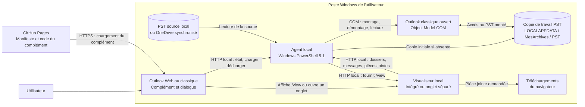

# Mes Archives — dossier de présentation

Version de travail du 23 novembre 2026. Ce document décrit le prototype de la branche `client-lourd-seul`, pas une solution validée pour la production.

## 1. Synthèse pour les décideurs

**Besoin.** Permettre à un utilisateur de retrouver et consulter ses archives Outlook au format PST, par année, avec une interface familière et sans importer automatiquement les messages dans Exchange.

**Réponse proposée.** Un complément Outlook ouvre une fenêtre « Mes Archives ». Un agent exécuté sur le poste, avec Outlook classique, monte une copie locale du PST et fournit un visualiseur à trois volets : dossiers, liste des messages et lecture. Les pièces jointes sont téléchargeables à la demande.

**Décision demandée.** Valider un pilote restreint et supervisé, avec données de test puis données autorisées, après revue sécurité, conformité, poste de travail et exploitation. La généralisation ne doit pas être décidée sur la seule base de ce prototype.

**Valeur attendue.** Interface homogène, conservation des archives hors boîte Exchange, lecture rapide sur le poste. **Coûts et dépendances.** Outlook classique, agent local Windows, PST disponibles sur le poste, assistance et gestion des mises à jour.

## 2. Fonctionnement pour l'utilisateur

1. Démarrer Outlook classique et l'agent local sur le même poste.
2. Ouvrir « Mes Archives » dans Outlook. Pour chaque année, l'indicateur signale disponible, indisponible ou état inconnu. Si la vérification échoue, l'état reste inconnu : il ne faut pas le confondre avec un PST absent.
3. Charger une archive : l'agent recherche le fichier source, crée si nécessaire une copie locale de travail, la monte dans Outlook, puis vérifie l'état obtenu. Décharger démonte la copie de travail.
4. Afficher le visualiseur intégré ou ouvrir son onglet séparé. Sélectionner l'année, un dossier puis un message. Le corps apparaît en texte brut ; cliquer sur une pièce jointe demande son téléchargement au navigateur.
5. Si une adresse SMTP est résolue, cliquer sur l'expéditeur ou un destinataire prépare un nouveau message dans l'application de messagerie par défaut. Une adresse Exchange non résolue est signalée comme indisponible ; aucun message n'est envoyé automatiquement.
6. La progression présente les étapes réellement observables par l'interface. Après une seconde, elle demande de patienter. La barre représente les étapes terminées, **pas** le pourcentage d'octets copiés ni une durée estimée.

Le parcours détaillé et les commandes de démarrage figurent dans [VISUALISEUR-LOCAL.md](./VISUALISEUR-LOCAL.md).

### Limites fonctionnelles

- Messages uniquement : les rendez-vous, contacts et autres éléments ne sont pas affichés. Listes de 50 éléments du dossier par page ; les éléments non-messages comptent dans la pagination.
- Pas de rendu HTML ou d'images intégrées, pas de recherche globale, pas de réponse ou transfert du message archivé ; un lien d'adresse crée un nouveau message.
- La résolution SMTP dépend des informations présentes dans Outlook et, pour certains correspondants Exchange, de l'annuaire accessible. Elle peut être indisponible ou déclencher des restrictions de sécurité Outlook.
- Le visualiseur est en lecture seule fonctionnelle. Outlook peut néanmoins modifier des données internes du PST monté. Il ne faut pas interpréter cela comme une garantie d'immuabilité.
- La copie locale de travail est réutilisée et n'est pas automatiquement mise à jour si la source change. Les autres applications locales et les téléchargements restent soumis aux règles de sécurité du poste.

## 3. Architecture technique

### Vue des composants et des flux



Le site HTTPS et le navigateur accèdent à l'agent sur le même poste via la boucle locale. Le schéma représente les dépendances, pas une publication de messages vers le site. Une source OneDrive doit être synchronisée et disponible localement ; la copie de travail existante n'est pas actualisée automatiquement.

### Parcours de chargement et de consultation

```mermaid
sequenceDiagram
    actor U as Utilisateur
    participant C as Dialogue Mes Archives
    participant A as Agent local
    participant S as PST source
    participant W as Copie de travail
    participant O as Outlook classique
    participant V as Visualiseur local

    U->>C: Choisit une année et Charger
    C->>A: État puis demande de montage
    A->>W: Recherche la copie existante
    alt Copie absente
        A->>S: Recherche le PST source disponible
        A->>W: Crée la copie locale
    else Copie présente
        Note over A,W: Réutilisation sans actualisation depuis la source
    end
    A->>O: Monte la copie via COM
    C->>A: Vérifie l'état
    U->>C: Ouvre le visualiseur intégré ou séparé
    C->>V: Affiche ou ouvre /view
    U->>V: Sélectionne dossier et message
    V->>A: Demande dossiers et message
    A->>O: Lit le PST monté via COM
    O-->>A: Données du dossier et du message
    A-->>V: Réponse locale ; corps en texte brut
    opt Pièce jointe demandée
        U->>V: Clique sur la pièce jointe
        V->>A: Demande le téléchargement
        A->>O: Récupère la pièce jointe
        A-->>V: Transmet le fichier
        Note over A,V: Fichier temporaire côté agent, puis téléchargement navigateur
    end
    opt Déchargement
        U->>C: Choisit Décharger
        C->>A: Demande de démontage
        A->>O: Démonte la copie via COM
        Note over W: La copie locale est conservée
    end
```

Le manifeste identifie le complément et les URL HTTPS ; le code du dialogue et des commandes est hébergé sur GitHub Pages. L'agent écoute par défaut sur `127.0.0.1:45731` ; cette adresse concerne le poste où le navigateur s'exécute. Le dialogue appelle l'agent pour l'état et le montage ; le visualiseur, servi par l'agent, utilise les routes `/folder`, `/message` et `/attachment`.

L'agent recherche les noms autorisés par sa configuration et utilise `%LOCALAPPDATA%\MesArchives\PST` pour la copie de travail. Outlook classique doit être déjà ouvert : l'agent s'y attache par COM avec Windows PowerShell 5.1. Une pièce jointe passe temporairement par un fichier local avant transmission puis suppression ; le navigateur choisit ensuite son dossier de téléchargement. Aucun flux d'import Exchange/Graph n'est déclenché par le visualiseur. Le PST source, le code du site, le navigateur, les journaux et les téléchargements peuvent néanmoins relever de politiques de synchronisation ou de conservation distinctes.

### Frontières et sécurité

Le site autorisé et tous les logiciels locaux capables d'appeler l'agent sont dans le périmètre de confiance. CORS, contrôles d'origine sur les routes de lecture et CSP réduisent certaines expositions mais **ne constituent pas une authentification des processus locaux** ; les routes de montage et d'état demandent également une revue dédiée. La communication loopback HTTP, l'intégrité du code GitHub Pages, la distribution de l'agent, les droits du compte, les pièces jointes et les données temporaires doivent être validés par la sécurité avant production.

Le dépôt GitHub est public : aucun PST réel, message, pièce jointe, capture sensible, identifiant ou secret ne doit être publié. Des fichiers PST sont déjà suivis dans l'historique du dépôt : vérifier leur nature et, s'ils contiennent des données réelles, déclencher immédiatement la procédure interne de gestion d'incident ; une simple suppression dans un nouveau commit ne les retire pas de l'historique.

## 4. Enjeux et défis

| Enjeu | Défi / adaptation | Préconisation |
|---|---|---|
| Confidentialité | PST, pièces jointes et copies locales peuvent contenir des données sensibles. | Classification, chiffrement et contrôle d'accès du poste, antivirus, règles de téléchargement et revue de l'agent ; vérifier les journaux et le dépôt public. |
| Pérennité | Dépendance à Outlook classique, COM et Windows PowerShell 5.1. | Cartographier les versions prises en charge ; tester sur postes administrés et prévoir une trajectoire de remplacement. |
| Cohérence | La copie locale peut différer de la source, et un PST ouvert peut être verrouillé. | Procédure de synchronisation, sauvegarde et renouvellement maîtrisé ; ne jamais écraser une copie sans analyse et fermeture. |
| Expérience | Traitements longs et multiples zones de défilement. | Étapes et barre basées sur les événements connus, volet unique de défilement et actions accessibles ; vérifier en conditions réelles. |
| Déploiement | Code web, manifeste et agent local évoluent indépendamment. | Versionner les composants, publier une version testée sur un site contrôlé, distribuer l'agent signé et supervisé, prévoir retour arrière. |
| Migration | PST multiples et potentiels doublons. | Inventaire, volumétrie, conservation et pilote ; comparer maintien local et import gouverné en boîte Exchange. |

## 5. Recommandations et références Microsoft

- **API de dialogue Office.** Utiliser une URL de dialogue HTTPS sur le même domaine initial que le complément ; le dialogue communique avec son parent et c'est le parent qui appelle `Dialog.close()`. Une seule boîte par page hôte ; la fermeture est asynchrone. [Règles et bonnes pratiques de l'API de dialogue](https://learn.microsoft.com/fr-fr/office/dev/add-ins/develop/dialog-best-practices).
- **PST et OneDrive.** Microsoft décrit la copie d'un PST hors du dossier OneDrive et la reconnexion d'Outlook à cette copie. Éviter d'utiliser directement comme fichier actif un PST synchronisé sans validation de la politique de l'entreprise. [Déplacer un fichier de données Outlook hors de OneDrive](https://support.microsoft.com/en-us/onedrive/how-to-remove-an-outlook-pst-data-file-from-onedrive).
- **Nouvel Outlook.** Microsoft documente désormais l'ouverture, la lecture et la recherche d'e-mails PST avec des limites et prérequis variables. Cela ne rend pas cet agent COM compatible avec le nouvel Outlook : valider séparément la version et les scénarios. [Ouvrir des éléments PST](https://support.microsoft.com/en-gb/outlook/open-and-find-items-in-an-outlook-data-file-pst?nochrome=true).
- **Alternative d'entreprise.** Microsoft Purview propose l'import PST vers Microsoft 365 ; c'est une migration avec traitement cloud et gouvernance, non le fonctionnement de ce prototype. Évaluer quotas, sécurité, doublons et conservation avant décision. [Import de fichiers PST](https://learn.microsoft.com/en-us/purview/importing-pst-files-to-office-365) et [FAQ de l'import](https://learn.microsoft.com/en-us/purview/pst-import-faq).

## 6. Déploiement et points à valider

Les changements locaux sur `client-lourd-seul` ne sont pas automatiquement visibles dans la branche `main` ni sur GitHub Pages. Pousser une branche, publier le site et installer le manifeste sont des actions distinctes. Le site et l'agent doivent être issus de versions compatibles ; après mise à jour de l'agent ou du visualiseur local, arrêter et relancer l'agent.

Pour le pilote : tester les quatre années, présence/absence d'Outlook, PST absent ou verrouillé, droits restreints, erreur réseau locale, grands dossiers, pièces jointes, SMTP Exchange non résolu, fermeture du dialogue dans Outlook et dans le navigateur, accessibilité clavier, et comportement réel de GitHub Pages et des politiques entreprise. Le prototype ne permet pas de déduire une homologation Microsoft ou sécurité.

## 7. Archive de démonstration

Le script [create-demo-pst.ps1](../tools/create-demo-pst.ps1) crée un PST `ADR_2021.pst` séparé contenant uniquement un message fictif et une pièce jointe fictive. Outlook enregistre brièvement le message comme brouillon fictif avant son déplacement dans le PST ; aucun message n'est envoyé. Le script refuse de remplacer un fichier existant et nécessite Outlook classique ouvert. Exécuter dans un dossier de démonstration vide, jamais dans le dossier contenant l'archive réelle :

```powershell
powershell.exe -NoProfile -File 'C:\DEV\MesArchivesAddin\tools\create-demo-pst.ps1' -DestinationDirectory 'C:\chemin\demo-vide'
```

Pour l'utiliser via l'agent, lancer celui-ci avec ce dossier comme source **et un répertoire LOCALAPPDATA de test isolé** : sinon la copie de travail 2021 existante sera réutilisée. Exemple dans une nouvelle fenêtre PowerShell, en adaptant les deux chemins de démonstration :

```powershell
$env:LOCALAPPDATA = 'C:\chemin\demo-local-isole'
powershell.exe -NoProfile -File 'C:\DEV\MesArchivesAddin\tools\local-pst-agent.ps1' -PstSourceDirectory 'C:\chemin\demo-vide'
```

Cette variable est modifiée uniquement pour cette fenêtre et ses processus enfants. Ne pas lancer deux agents sur le même port. Outlook peut garder le nouveau PST verrouillé après démontage ; si la copie échoue, fermer normalement Outlook, attendre sa fermeture complète, puis le rouvrir avant de réessayer. Ne jamais supprimer ou remplacer la copie de travail réelle pour le test.
